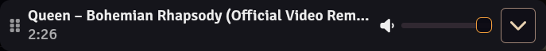
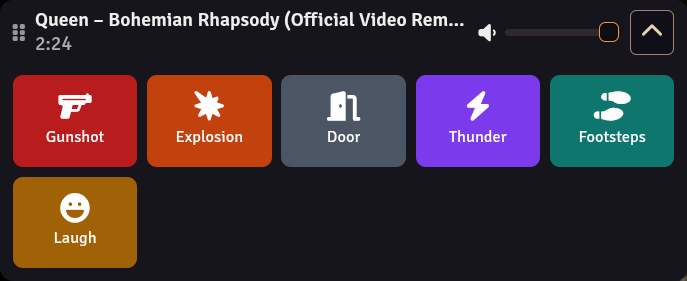
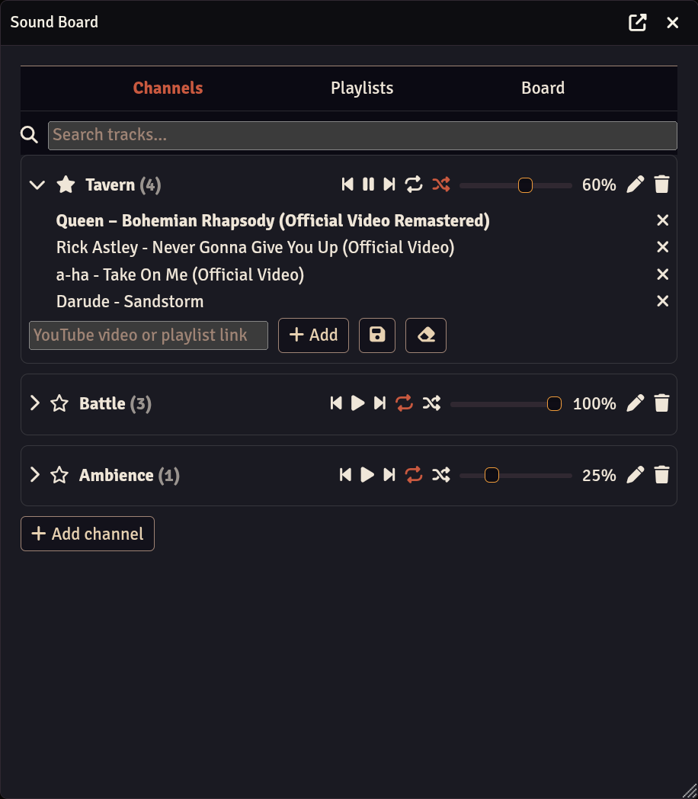
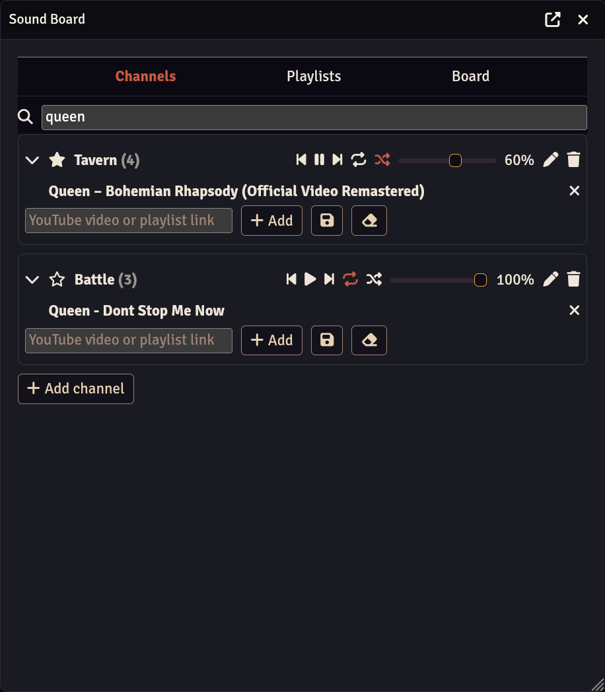
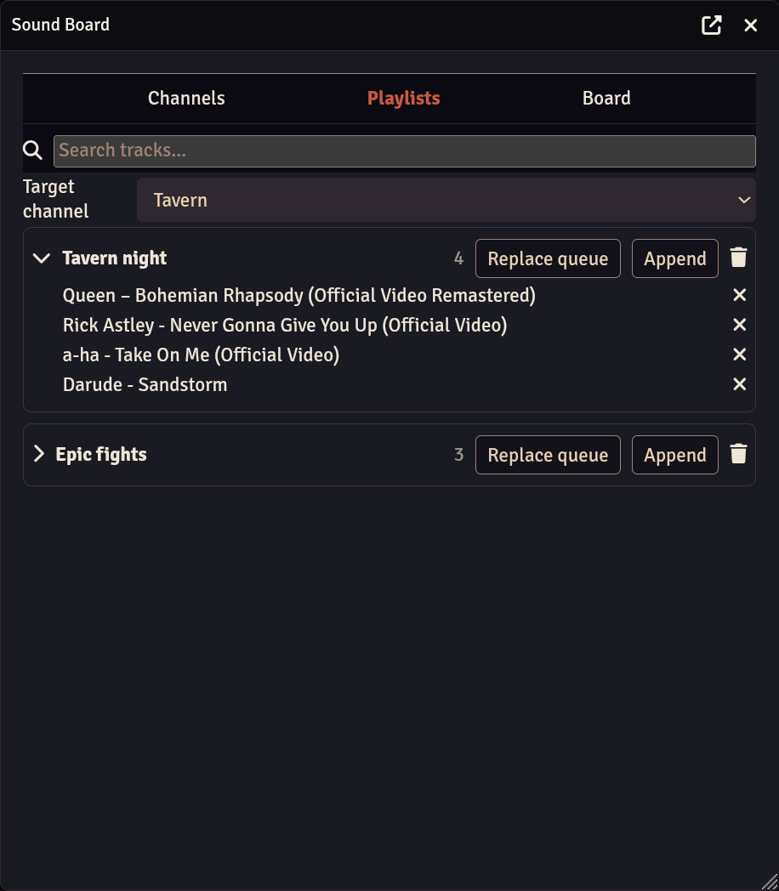
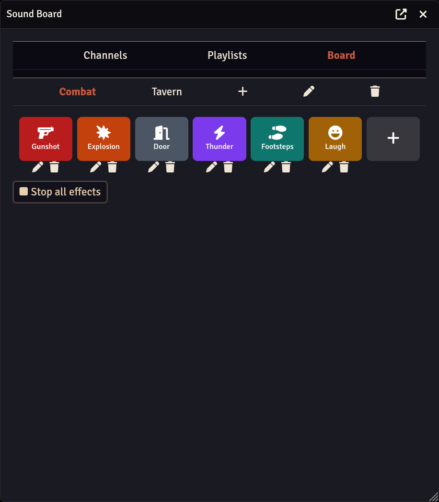

# Foundry Sound Board (Foundry v13)

GM-controlled, synced audio for every player: YouTube music channels, effects, saved playlists and a Streamdeck-style board.

Install: copy this folder to `Data/modules/foundry-sound-board` and enable it in the world.

- **Widget (everyone):** title, `m:ss / total`, general volume; the chevron shows the board buttons the GM allowed. Drag it by the grip.
- **Manager (GM, sliders icon):** channels with queues (play/pause/skip, loop, shuffle, volume, main channel star), saved playlists, boards.
- **Shuffle:** reorders the queue (current track keeps playing) and reshuffles every round, looping.
- **Search:** filters tracks across all channels / playlists; every track has an ✕ to remove it. Chevrons fold channels and playlists.
- **Volume:** effective = channel x general, so the general slider scales every channel proportionally.
- Saved playlists, channels and boards live in world settings, so any browser/GM device of that world sees them.

Audio plays through hidden official YouTube IFrame players: every client needs internet and one click per session ("Enable audio").

| | |
|---|---|
|  |  |
|  |  |

## AI disclosure

This module was written with the help of an AI coding assistant (an AI agent working under the author's direction). The author defined the requirements, reviewed the code and tested it in a live Foundry world.
